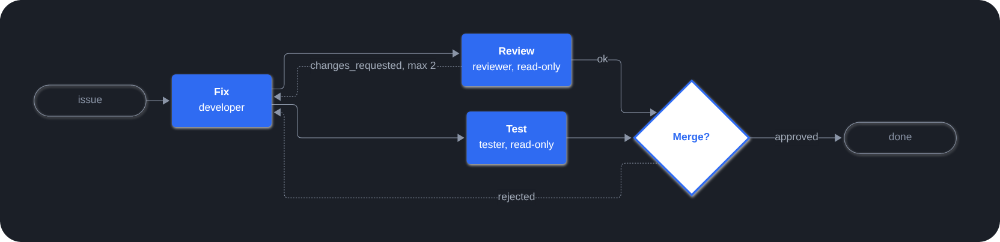

Playbooks transforme un workflow multi-agents en un fichier YAML dans votre dépôt. Un agent
manager l'exécute étape par étape, chaque étape confiée à un sous-agent, et s'arrête aux
validations humaines (gates) pour vous laisser décider.

## Exemple

`.paseo/plugins/playbooks/fix.yaml` : corriger, puis relire et tester en parallèle, revenir
en arrière si des changements sont demandés, et demander à un humain avant de finir. Les
rôles sont définis une fois dans `roles/<id>/`.



```yaml
title: Fix a bug
inputs:
  issue: { type: string, required: true }

steps:
  - id: fix
    role: { name: developer, prompt: "Fix {{ inputs.issue }} and add a test." }
    inputs: [issue]

  - id: review                                         # review et test tournent en parallèle :
    role: { name: reviewer, prompt: Review the fix. }  # leurs rôles sont en lecture seule
    needs: [fix]
    outcomes: [ok, changes_requested]
    on:
      changes_requested: { goto: fix, max_loops: 2 }

  - id: test
    role: { name: tester, prompt: Run the test suite. }
    needs: [fix]

  - id: approve               # validation humaine : Approve ou Reject
    needs: [review, test]
    gate: { question: Merge this fix? }
    on:
      rejected: { goto: fix }
```

## Fonctionnalités

- **Workflows versionnés** : les playbooks, les rôles partagés et les réglages par défaut
  des agents vivent dans `.paseo/plugins/playbooks/`. Voir la
  [référence du format](https://playbooks.paseo.lerenn.dev/reference.html).
- **Étapes en parallèle et boucles** : les étapes forment un graphe via `needs`, et les
  boucles reviennent en arrière avec `goto` et une limite. Les after-tasks, comme une
  rétrospective, s'exécutent à la fin de l'exécution.
- **Étapes script** : le travail déterministe, comme attendre qu'une PR soit mergée ou
  qu'un déploiement se termine, tourne comme un script du dossier `scripts/` du playbook,
  sans agent.
- **Validations humaines** : approuvez, rejetez ou choisissez une option depuis le panneau
  ou dans la conversation.
- **Règles appliquées par le plugin** : il valide les playbooks, refuse les transitions
  qu'un playbook n'autorise pas, vérifie les rôles en lecture seule avec git et conserve
  l'état des exécutions malgré les redémarrages du daemon. Voir
  [le fonctionnement](https://playbooks.paseo.lerenn.dev/how-it-works.html).
- **Graphe en direct** : le panneau Playbooks, dans la barre latérale du workspace, montre
  chaque exécution au fil de l'eau. Depuis ce panneau, vous pouvez lancer, mettre en pause,
  reprendre ou annuler une exécution, ou la relancer depuis une étape.
- **Toutes les exécutions sur un écran** : une entrée Playbooks dans la barre latérale gauche
  de Paseo, avec en badge le nombre de validations qui vous attendent, liste les exécutions de
  tous les workspaces par playbook, chacune avec sa progression d'étape en étape. Vous pouvez
  y trancher une validation sans ouvrir le workspace.

## Pour commencer

- [Prise en main](https://playbooks.paseo.lerenn.dev/getting-started.html) : écrire,
  valider et lancer un premier playbook.
- [Exemples](https://playbooks.paseo.lerenn.dev/examples.html) : un workflow de pull
  request, une livraison avec recette, un playbook qui enchaîne les deux via une validation
  humaine, et une vérification de documentation.
- [Skill pour agents](https://github.com/lerenn/paseo-playbooks/blob/main/skills/paseo-playbooks/SKILL.md) :
  apprend à vos agents à écrire des playbooks.

## Bon à savoir

- Avant la 1.0 : toute version mineure peut modifier le format des playbooks de façon incompatible. Épinglez une version et lisez les notes de version avant de mettre à jour.
- Les étapes peuvent utiliser n'importe quel mode d'agent, `bypassPermissions` compris. Ne
  lancez que des playbooks de dépôts en lesquels vous avez confiance.
- Tous les agents, sauf ceux des étapes, peuvent lister, annuler, relancer ou reprendre
  des exécutions, et lancer des after-tasks manuelles, depuis n'importe quelle
  conversation. Voir [les outils](https://playbooks.paseo.lerenn.dev/how-it-works.html).
- Nécessite Paseo 0.14 ou plus récent. L'état des exécutions est conservé dans
  `$PASEO_HOME/plugin-data/paseo-playbooks/runs/` jusqu'à l'archivage du worktree de
  l'exécution. Le code serveur exécute `git` dans les dossiers des workspaces, et lance les
  étapes script (des exécutables du dossier `scripts/` du playbook) dans le worktree de
  l'exécution.
