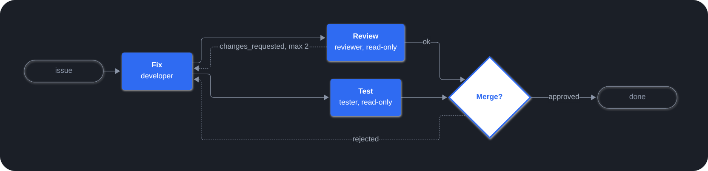

Playbooks turns a multi-agent workflow into a YAML file in your repository. A manager agent
runs it step by step, each step as a subagent, and stops at human gates for your decision.

## Example

`.paseo/plugins/playbooks/fix.yaml`: fix, then review and test in parallel, loop back on
requested changes, and ask a human before finishing. Roles are defined once in `roles/<id>/`.

```yaml
title: Fix a bug
inputs:
  issue: { type: string, required: true }

steps:
  - id: fix
    role: developer
    inputs: [issue]
    prompt: "Fix {{ inputs.issue }} and add a test."

  - id: review                # review and test run in parallel:
    role: reviewer            # their roles are read-only
    needs: [fix]
    outcomes: [ok, changes_requested]
    prompt: Review the fix.
    on:
      changes_requested: { goto: fix, max_loops: 2 }

  - id: test
    role: tester
    needs: [fix]
    prompt: Run the test suite.

  - id: approve               # human gate: Approve or Reject
    needs: [review, test]
    gate: Merge this fix?
    on:
      rejected: { goto: fix }
```



## Features

- **Workflows as code**: playbooks, shared roles and agent defaults live in
  `.paseo/plugins/playbooks/`. See the [format reference](https://playbooks.paseo.lerenn.dev/reference.html).
- **Parallel steps and loops**: steps form a graph through `needs`, and loops go back with
  `goto` and a limit. After-tasks, such as a retro, run once the run ends.
- **Human gates**: approve, reject or pick a choice from the panel or in chat.
- **Rules enforced by the plugin**: it validates playbooks, refuses transitions a playbook
  does not allow, checks read-only roles with git, and keeps run state across daemon
  restarts. See [how it works](https://playbooks.paseo.lerenn.dev/how-it-works.html).
- **Live graph**: the Playbooks panel in the workspace sidebar shows each run as it goes.
  From it you can start, pause, resume or cancel a run, or restart it from a step.

## Get started

- [Getting started](https://playbooks.paseo.lerenn.dev/getting-started.html): write,
  validate and run a first playbook.
- [Examples](https://playbooks.paseo.lerenn.dev/examples.html): a pull-request workflow, a
  release with QA, a capability chaining both through a gate, and a docs check.
- [Agent skill](https://github.com/lerenn/paseo-playbooks/blob/main/skills/paseo-playbooks/SKILL.md):
  teaches your agents to write playbooks.

## Good to know

- Steps may run in any agent mode, `bypassPermissions` included. Only start playbooks from
  repositories you trust.
- Every agent except step agents can list, cancel, restart or take over runs, and start
  manual after-tasks, from any chat. See the [tools](https://playbooks.paseo.lerenn.dev/how-it-works.html).
- Requires Paseo 0.14 or later. Run state is kept in
  `$PASEO_HOME/plugin-data/paseo-playbooks/runs/` until the run's worktree is archived.
  Server code runs `git` in workspace folders.
