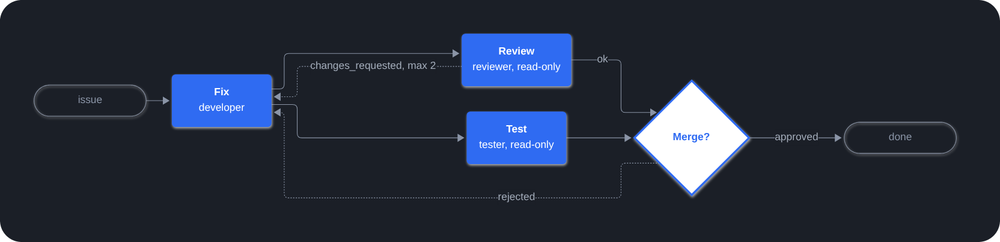

**Stop supervising every agent. Start shipping a repeatable engineering system.**

Playbooks turns "what happens next?" into versioned YAML in your repository. A manager agent
runs it step by step, each step as a subagent or a script, in parallel or in loops, and stops
at human gates for your decision. Specialist agents handle judgment, scripts handle facts,
and the graph is reviewed and versioned like any other engineering code.

Playbooks turns a multi-agent workflow into a YAML file in your repository. A manager agent
runs it step by step, each step as a subagent, and stops at human gates for your decision.

## Example

`.paseo/plugins/playbooks/fix.yaml`: fix, then review and test in parallel, loop back on
requested changes, and ask a human before finishing. Roles are defined once in `roles/<id>/`.



```yaml
title: Fix a bug
inputs:
  issue: { type: string, required: true }

steps:
  - id: fix
    role: { name: developer, prompt: "Fix {{ inputs.issue }} and add a test." }
    inputs: [issue]

  - id: review                                         # review and test run in parallel:
    role: { name: reviewer, prompt: Review the fix. }  # their roles are read-only
    needs: [fix]
    outcomes: [ok, changes_requested]
    on:
      changes_requested: { goto: fix, max_loops: 2 }

  - id: test
    role: { name: tester, prompt: Run the test suite. }
    needs: [fix]

  - id: approve               # human gate: Approve or Reject
    needs: [review, test]
    gate: { question: Merge this fix? }
    on:
      rejected: { goto: fix }
```

## Features

- **Workflows as code**: playbooks, shared roles and agent defaults live in
  `.paseo/plugins/playbooks/`. See the [format reference](https://playbooks.paseo.lerenn.dev/reference.html).
- **Parallel steps and loops**: steps form a graph through `needs`, and loops go back with
  `goto` and a limit. After-tasks, such as a retro, run once the run ends.
- **Script steps**: deterministic work, such as waiting for a PR to merge or a deploy to
  finish, runs as a script from the playbook's `scripts/` folder, with no agent.
- **Human gates**: approve, reject or pick a choice from the panel or in chat.
- **Rules enforced by the plugin**: it validates playbooks, refuses transitions a playbook
  does not allow (loops are bounded by `max_loops`, and a run's own agents cannot approve their own human gate), checks read-only roles with git, and keeps run state across daemon
  restarts. See [how it works](https://playbooks.paseo.lerenn.dev/how-it-works.html).
- **Provider fallback**: a tier in `defaults/main.yaml` may list several providers. When a
  step agent runs out of tokens, the same attempt restarts on the next one, and the exhausted
  provider is tried again after `providers: { exhausted_for }` (1h by default). A quota-stuck
  manager also moves to its configured fallback without replaying steps or changing gates;
  `recover_manager` repairs an already-stuck idle manager with an expected-owner check.
- **Live graph**: the Playbooks panel in the workspace sidebar shows each run as it goes.
  From it you can start, pause, resume or cancel a run, or restart it from a step.
- **Every run on one screen**: a Playbooks entry in Paseo's left sidebar, badged with the
  gates waiting for you, lists the runs of all workspaces by playbook, each with its
  progress across the steps. Decide a gate from there without opening the workspace.
- **A Sidekick per project**: a chat column on the Playbooks screen, one tab per project, with a
  coordinator agent defined by a `sidekick/` folder beside the playbooks. It watches the runs, judges
  which decisions could be automated, and sends subagents to change the playbooks in pull requests
  you merge. Its prompt forbids it to edit files or run commands itself.

## Also

- **Burn rate limiting**: quota pacing against the provider's usage windows (maximum usable quota, closed hours, burn rate, priorities, exempt runs).
- **Warden**: an opt-in periodic pass that flags stale definitions, loops, blocked managers, slow steps, long-open gates and held runs.
- **Usage log and analytics**: one line of counters per agent turn, and an Analytics tab in the panel.
- **Panel tabs and languages**: a **+** button opens Analytics, Burn rate limiting, Off hours and Profiles; the panel is translated into French and Simplified Chinese.
- **Fan-out pools and pipelines**: one run per item of a list, and singleton pipelines that batch jobs through stages.
- **Recovery**: restart a run from a step; `recover_manager` and automatic recovery of a manager stuck on its provider's quota.

## Get started

- [Getting started](https://playbooks.paseo.lerenn.dev/getting-started.html): write,
  validate and run a first playbook.
- [Examples](https://playbooks.paseo.lerenn.dev/reference.html): a pull-request workflow, a
  release with QA, a capability combining both through a gate, and a docs check.
- [Agent skill](https://github.com/lerenn/paseo-playbooks/blob/main/skills/paseo-playbooks/SKILL.md):
  teaches your agents to write playbooks.

## Good to know

- Pre-1.0: any minor release may change the playbook format in breaking ways. Pin a release tag and read the release notes before upgrading.
- Steps may run in any agent mode, `bypassPermissions` included. Only start playbooks from
  repositories you trust.
- Every agent except step and gate agents can list, cancel, restart or take over runs, and start
  manual after-tasks, from any chat. See the [tools](https://playbooks.paseo.lerenn.dev/how-it-works.html).
- Requires Paseo 0.16 or later. Run state is kept in
  `$PASEO_HOME/plugin-data/lerenn/paseo-playbooks/runs/`. Archiving a run hides it and keeps its state, and `restart_run` can reopen it. By default it also archives the run's workspace when that is safe (`workspace: { archive_with_run: false }` turns this off). The run's worktree is removed when the run ends (a failed run's is kept for 24 hours, unless the volume is high), which does not delete its state.
  Server code runs `git` in workspace folders, and runs script steps (executables from
  the playbook's `scripts/` folder) in the run's worktree.
