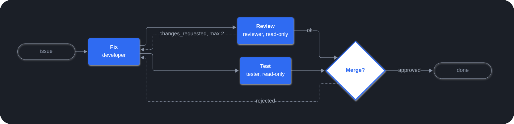

Playbooks 把多智能体工作流写成仓库里的一个 YAML 文件。由一个 manager 智能体逐步执行，每个步骤交给一个子智能体，并在人工审批关卡（gate）处暂停，等你决定。

## 示例

`.paseo/plugins/playbooks/fix.yaml`：先修复，再并行评审和测试，需要修改时回到修复步骤，结束前请人工确认。角色只需在 `roles/<id>/` 中定义一次。



```yaml
title: Fix a bug
inputs:
  issue: { type: string, required: true }

steps:
  - id: fix
    role: { name: developer, prompt: "Fix {{ inputs.issue }} and add a test." }
    inputs: [issue]

  - id: review                                         # review 和 test 并行运行：
    role: { name: reviewer, prompt: Review the fix. }  # 它们的角色是只读的
    needs: [fix]
    outcomes: [ok, changes_requested]
    on:
      changes_requested: { goto: fix, max_loops: 2 }

  - id: test
    role: { name: tester, prompt: Run the test suite. }
    needs: [fix]

  - id: approve               # 人工审批：Approve 或 Reject
    needs: [review, test]
    gate: { question: Merge this fix? }
    on:
      rejected: { goto: fix }
```

## 功能

- **工作流即代码**：playbook、共享角色和智能体默认配置都放在 `.paseo/plugins/playbooks/` 中。参见[格式参考](https://playbooks.paseo.lerenn.dev/reference.html)。
- **并行步骤和循环**：步骤通过 `needs` 组成一张图，循环通过带次数上限的 `goto` 回跳。收尾任务（例如复盘）在运行结束后执行。
- **脚本步骤**：确定性的工作（例如等待 PR 合并或部署完成）以 playbook 的 `scripts/` 目录中的脚本运行，无需智能体。
- **人工审批**：在面板或对话中批准、拒绝或选择一个选项。
- **由插件执行规则**：插件校验 playbook，拒绝 playbook 不允许的流转，通过 git 检查只读角色，并在 daemon 重启后保留运行状态。参见[工作原理](https://playbooks.paseo.lerenn.dev/how-it-works.html)。
- **提供商回退**：`defaults/main.yaml` 中的一个 tier 可以列出多个提供商。步骤智能体的 token 用尽时，同一次尝试会在下一个提供商上重新开始；用尽的提供商在 `providers: { exhausted_for }`（默认 1h）之后会被再次尝试。
- **实时流程图**：工作区侧边栏中的 Playbooks 面板实时显示每次运行。可以在面板中启动、暂停、恢复或取消运行，或从某个步骤重新开始。
- **所有运行一屏总览**：Paseo 左侧边栏中的 Playbooks 入口以徽标显示等待你处理的审批数，并按 playbook 分组列出所有工作区的运行及其在各步骤间的进度。无需打开工作区即可在这里完成审批。
- **每个项目一个 Sidekick**：Playbooks 屏幕右侧的聊天栏，每个项目一个标签页，由 playbook 旁的 `sidekick/` 文件夹定义协调智能体。它监视运行，判断哪些决策可以自动化，并派出子智能体在拉取请求中修改 playbook，由你合并。它自己没有 shell 和文件工具。

## 快速开始

- [入门指南](https://playbooks.paseo.lerenn.dev/getting-started.html)：编写、校验并运行第一个 playbook。
- [示例](https://playbooks.paseo.lerenn.dev/examples.html)：pull request 工作流、带 QA 的发布流程、通过人工审批把两者组合起来的功能交付 playbook，以及文档检查。
- [智能体技能](https://github.com/lerenn/paseo-playbooks/blob/main/skills/paseo-playbooks/SKILL.md)：教你的智能体编写 playbook。

## 须知

- 1.0 之前：任何次版本都可能以不兼容的方式修改 playbook 格式。请固定到某个发布标签，升级前先阅读发布说明。
- 步骤可以使用任何智能体模式，包括 `bypassPermissions`。只运行来自可信仓库的 playbook。
- 除步骤智能体外，所有智能体都可以在任何对话中列出、取消、重新开始或接管运行，并启动手动收尾任务。参见[工具](https://playbooks.paseo.lerenn.dev/how-it-works.html)。
- 需要 Paseo 0.14 或更高版本。运行状态保存在 `$PASEO_HOME/plugin-data/lerenn/paseo-playbooks/runs/`，直到运行所在的 worktree 被归档。服务端代码会在工作区目录中运行 `git`，并在运行所在的 worktree 中执行脚本步骤（playbook 的 `scripts/` 目录中的可执行文件）。
