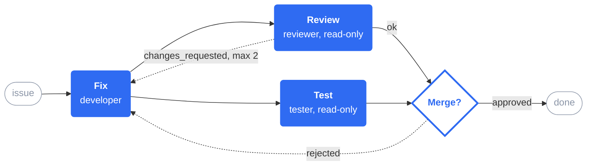
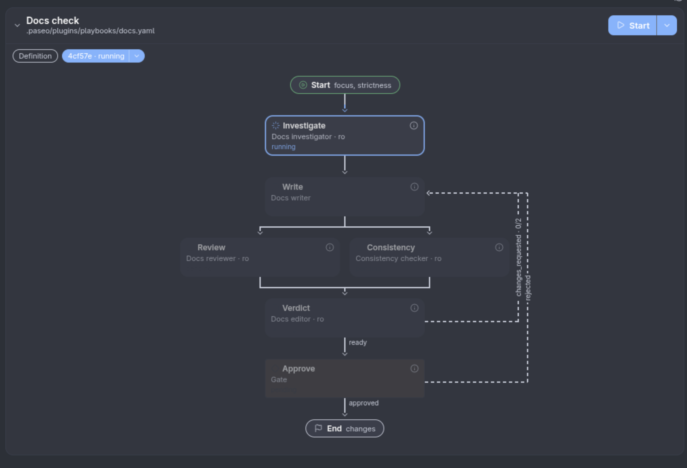
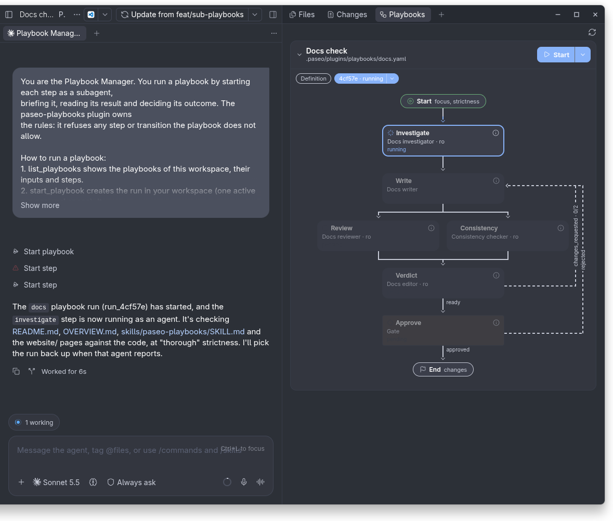
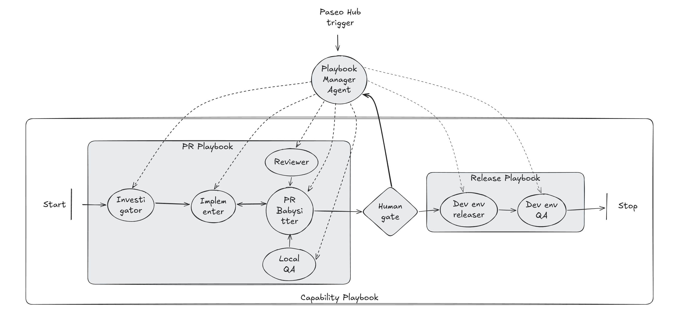

# Paseo Playbooks

> [!WARNING]
> Until v1.0, any minor release may change the playbook YAML format in breaking ways. Pin the
> plugin to a release tag (`paseo plugin install https://github.com/lerenn/paseo-playbooks.git --ref v0.7.0`,
> then `paseo plugin update paseo-playbooks --ref <tag>`) and read the release notes before upgrading.

Paseo plugin for multi-agent workflows: write a playbook in YAML, and a manager agent runs
each step as a subagent, in parallel or in loops, through to the human approval gates. See [OVERVIEW.md](OVERVIEW.md) for what it does and
[docs/adrs/2026-11-02-design.md](docs/adrs/2026-11-02-design.md) for the design.

The example playbook from the overview (fix, then review and test in parallel, then a human
gate), as a graph. The source is [assets/example-flow.mmd](assets/example-flow.mmd):





The panel next to the Playbook Manager's conversation, while a step runs:



How the Playbook Manager drives steps, human gates and nested playbooks:



## Layout

| Path | Contents |
| --- | --- |
| `index.server.ts`, `server/` | Daemon side: YAML loader and validator, run engine, run store, agent tools, hooks, RPC handlers |
| `index.client.tsx`, `client/` | The Playbooks panel (graph, node sheet, Start form), header button, and the sidebar entry with its all-workspaces screen |
| `shared/` | Zod types, RPC contracts, graph and template helpers |
| `examples/.paseo/plugins/playbooks/` | Example playbooks (PR, Release to dev, and Capability, which combines them as sub-playbooks) and their roles (not loaded by the plugin) |
| `.paseo/plugins/playbooks/` | This repository's own Docs check playbook (`docs.yaml`), which checks its docs, and its roles |
| `examples/.paseo/plugins/playbooks/sidekick/` | A starter Sidekick (`sidekick.yaml`, `instructions.md`) |
| `skills/paseo-playbooks/SKILL.md` | Agent skill for writing playbooks; copy or symlink it into a repo's `.agents/skills/` or `.claude/skills/` |

## The Sidekick

The Playbooks screen has a **Sidekick** button that opens a chat column on its right, with one tab per project
that has active runs or a Sidekick, and a **+** tab to add another project. A project's Sidekick is a
coordinator agent defined by a `sidekick/` folder beside its playbooks (`sidekick/sidekick.yaml` for provider,
model, mode, thinking and the events it `watch`es; `sidekick/instructions.md` for the repository's rules). It
runs in a hidden background workspace on the project root, watches the project's runs, judges which decisions
could be automated, and sends subagents to change the playbooks in pull requests that you merge. Its prompt
forbids it to edit files or run commands itself. A project without the folder shows a short tutorial and a button that writes
starter files. The `sidekick/` folder is not a playbook, so a playbook named `sidekick` still works.

A Sidekick may also live in `profiles/<id>/sidekick/`. Only active profiles participate; the first
alphabetically wins, ahead of the top-level folder, with warnings for ignored folders. Use
`sidekick: { tier: worker, subagents: { tier: worker } }` to resolve targets from the containing
repository/profile's `defaults/main.yaml`. Multi-entry tiers cannot have inline agent overrides.
Profile `agent_rules` apply to the Sidekick and its subagent briefs. The Sidekick skips targets at
the configured provider usage threshold and, on quota failure, moves through its tier followed by
`providers.fallback`, preserving its saved ledger and archiving the old agent first. Exhaustion is
remembered for `providers.exhausted_for` until plugin reload. Restarts and compaction replacements
use the same selection. When every target is exhausted, the failed agent remains visible without
an automatic retry. Subagent fallback is instructed through the Sidekick's prompt; the plugin does
not automatically replace those subagents.

The Sidekick is long-lived and found by its labels: `playbooks/sidekick` and `playbooks/project=<project id>`
(`paseo ls -g` lists them), so any agent can send it a prompt. It relays the human's answers to managers
(`send_agent_prompt`, `respond_to_permission`) and checks the gate moved, and creates its subagents on
`sidekick.subagents` (`provider`, `model`; default `claude` / `claude-sonnet-5-5`; optional `mode`, a Paseo
mode id such as `default`, `acceptEdits`, `plan`, `auto` or `bypassPermissions`, set on every subagent; unset, they
inherit the Sidekick's own `sidekick.mode`, and if that is unset too the plugin sends none and Paseo's default mode
for the provider applies; a value that is not a mode id is ignored with a warning); their finish notices wait
until it is idle. It can answer an open human gate of its project with `resume_gate` (also available to any agent outside the runs; set `gates: { on_behalf: deny }` in `defaults/main.yaml` to turn it off), only with the human's own answer given through its question tool; `gate.decided` shows `decidedBy: "agent <name> on behalf of the human"`. It saves a short decision ledger with `sidekick_handoff`. When its context passes
`sidekick.session.compact_above_tokens` (default 300000; its older name `restart_above_tokens` still works) its own conversation is compacted (`/compact`, sent while it is idle, with the ledger in the instructions and repeated to it afterwards): it stays the same agent, tab and chat, and the column shows "Compacting…". Only if compaction fails, or leaves it above `session.hard_limit_tokens` (default 1.5× the threshold), is it replaced by a new agent from the ledger, the old one archived first. A project never has two live Sidekicks (duplicates found at startup are archived).

The chat opens on the last 40 entries and reads 40 older ones each time you scroll near the top ("Loading older…", then "Start of the conversation"); your place is kept, and the view only follows new text while you are at the bottom.

A subagent that needs a place of its own gets a new hidden worktree workspace (the Sidekick creates it first with
`create_workspace { isolation: worktree, background: true }`; it never calls `create_agent` without a `workspaceId`,
which would put the subagent in the project's own checkout). Once such a subagent has finished and the Sidekick was told,
the plugin archives the subagent and its workspace after a grace period (`sidekick.subagents.archive_after`, default
`10m`; `sidekick.subagents.archive_workspace: false` turns it off). It only ever archives a hidden worktree workspace
that is not the project's root checkout, not a run's workspace and not the Sidekick's own, with no other agent in it,
nothing running or waiting on a permission, no uncommitted changes and no commits that are not pushed; otherwise it
keeps the workspace and logs why. The pending archives are saved and survive a restart.

Every ready agent step starts by itself: as soon as a step becomes ready (after a predecessor, a script, a gate, a loop-back or
a fan-in; also the steps of an after-task) the plugin starts it with its rendered prompt and inputs and an empty brief, with
the same model, role and workspace resolution as `start_step`. `start_playbook`'s `autoStart: false` keeps the steps ready at
the start in the manager's hands (later steps start by themselves). A step that needs a brief from the manager opts out with
`manage: { auto_start: false }`: it stays `ready` and the manager is woken to start it with `start_step`. `start_step` on a
step already running is refused (never started twice). The manager is woken only for what it must decide or what went wrong:
a reported step, a failure, a gate, a step waiting for a brief, a stall, the end of the run. A step that completes normally and
whose next step starts by itself stays in the run log; `manage: { notify: true }` wakes the manager for that step too. Both go in a step's
`manage:` block or in `manage:` of `defaults/main.yaml`. See `docs/adrs/2026-11-13-autostart-ready-agent-steps.md`.

A script step's sheet in the run graph shows whether a check is **running now** or the step is **waiting** ("next
check in ~30 s"), the running check's output (refreshed about every 2 s) and the last five checks with their
outcome and exit code. The output is kept in memory only (the last 4000 characters per check, gone when the step
ends or the daemon restarts, after which the run's recorded last-check output is shown) and is not redacted:
anyone who can see the panel sees what the script prints. Each check says what started it: the first run, the poll,
or an event ("woken by job.settled").

A script step can also wake on events: `script: { run: check.sh, poll: 10m, wake_on: [{ types: [job.advanced, job.settled],
filter: { playbook: other_pipeline, stage: production } }] }` runs a check at once when a matching event is emitted
(`types` take globs; `filter` matches payload fields by equality), and `poll` stays as the safety net (required). Events
during a running check cause one more check after it, never two at once; checks are at least 5 s apart; a step is not woken
by events about itself. See `examples/.paseo/plugins/playbooks/wait_for_upstream.yaml` and
`docs/adrs/2026-11-12-script-wake-on.md`.

### Admission on a stage's queue

A stage of a singleton pipeline can decide, per waiting job, who may join its next batch, with a script the plugin
runs itself (no batch, no manager, no agent):

```yaml
  - id: staging
    needs: [dev]
    playbook: { name: train }
    queue:
      mode: fifo
      admit:
        script: admit_staging.sh
        poll: 10m                       # required: the safety net
        wake_on:                        # optional; a new job of this queue always wakes it
          - { types: [job.advanced, job.settled], filter: { playbook: qa_pipeline, stage: smoke } }
```

The script runs in the pipeline's workspace and reads `PLAYBOOK_JOBS` (the stage's waiting jobs: `id`, `label`,
`since` and all their `inputs`), `PLAYBOOK_STAGE` and `PLAYBOOK_PIPELINE`. Its last stdout line is JSON:
`{"admit": ["job_a"], "hold": {"job_b": "QA not passed"}, "escalate": {"job_c": "dependency failed"}}`. A job it does
not name is held ("not admitted by the script"); exit 75 or a failure changes nothing (a failure shows as an alert on
the stage). A held job never blocks the others, and the panel shows each one's "Held" badge with the reason, since
when it waits and the last check. `escalate` also asks a human in "Needs you": check again, withdraw the job, or admit it
anyway. `job.held`, `job.admitted` (`via: script | human`) and `job.escalated` are public events. See
`examples/.paseo/plugins/playbooks/staged_release.yaml` and `docs/adrs/2026-11-12-event-core-queue-admission.md`.

The Sidekick can start playbook runs with `start_playbook` (a playbook with `isolation: { mode: worktree }` starts in the caller's workspace, or in `workspaceId`, in the run's private worktree, so several runs share one workspace and show in its Playbook panel; `newWorkspace: true` forces a new one. Any other playbook always starts in a NEW workspace: `workspaceId` then only names the workspace it is branched off, `workspaceName` titles it, and `newWorkspace: false` is refused. A Sidekick has no workspace of its own: it gets a new workspace, branched off its project's root, unless it passes `workspaceId` for an isolated playbook), and `list_playbooks` shows what is on offer. When you ask
it to merge a pull request, it starts the project's merging playbook (for example `pr-to-prod`), whose manager
merges; the Sidekick itself never merges. For bulk work ("do all tickets of project XYZ") it creates a coordinator
subagent that lists the tickets with its own MCP tools (the Sidekick has none) and starts one run per ticket.
`sidekick.runs: { max_concurrent, confirm_bulk }` sets limits: `max_concurrent` (unset: unlimited) is how many runs
of the project may be active at once, and `confirm_bulk: true` (default `false`) makes it ask you before launching
more than one run in a batch. Both are rules in its prompt, not enforced by the plugin.

You can paste or drop images and files (web) in the Sidekick's message box (up to 8 per message; images 5 MB,
other files 10 MB, 25 MB in total; executables are refused). Each shows as a removable chip, with a thumbnail
for images. Images reach the agent as image content blocks, the way Paseo's own composer sends them. Other
files are saved on the host under the system temp folder (`paseo-playbooks-attachments/`, kept a week) and
their paths are added to the message.

While the Sidekick works, **Enter** sends the message into the running turn (steering it). **Cmd+Enter**
(Ctrl+Enter elsewhere) or the **Queue** button holds it instead: it shows as a pending line above the box, with
an x to cancel, and is sent when the turn ends. When the Sidekick is idle, Cmd+Enter just sends. The queue is
kept by the column (per project, this session only), not by the daemon.

## Panel languages

The panel follows the Paseo app language: English, French (`fr`) and Simplified Chinese
(`zh-CN`), with English as the fallback for any other language or any string not yet
translated. The messages live in `client/i18n.ts` (`defineTranslations` from `@getpaseo/plugin`).
The panel chrome, the Start and Run Playbook forms and the registration titles are translated so
far; run cards, statuses, the graph, analytics and the Sidekick follow in later steps. A new
user-facing string in a translated component goes into all three languages in the same pull
request. Playbook text written by authors is shown as written. See
`docs/adrs/2026-11-20-panel-ui-translations.md`.

## Develop

```bash
npm install
npm run typecheck
npm test
```

Install on a local daemon from a stable checkout (not a Paseo worktree, which can be
archived), then reload after each change:

```bash
paseo plugin install "$PWD"
paseo plugin reload paseo-playbooks
paseo plugin logs paseo-playbooks
```

### Event log and job events

Run state is still one JSON file per run. Next to it, a pipeline (a singleton's run) and its batches keep an
append-only **event log**, `<run id>.events.jsonl`, in the plugin's `runs/` folder: one line per fact about its jobs
(`job.queued`, `job.joined`, `job.advanced`, ...), the first step of the event core (ADR
`docs/adrs/2026-11-12-event-core.md`). In this version the log changes nothing: the run file stays the source of truth,
and the log is checked against it. Two settings in the user config
(`$PASEO_HOME/plugin-data/lerenn/paseo-playbooks/config.yaml`, read when the plugin starts, so reload after editing):

```yaml
event_core:
  log: true        # false: write no log and check nothing (the way back; state is the same either way)
  parity: warn     # warn: log a line when the log's reducers and the run state disagree; off: no check
```

The pipeline's jobs are also announced on the event bus, for `subscribe_events` and `list_events`:
`job.queued` (waits at a stage: handed off, or unlocked by a passed stage; one event per stage),
`job.joined`, `job.advanced` (passed a stage), `job.requeued` (back at its stage: its batch failed with retries left, `cause: batch_failed`, or a step's outcome the playbook declares `settle.effects: { <outcome>: requeue }` set it aside, `cause: outcome`, with `reason` and `blocker`),  `job.reopened` (`requeue_job` put a failed or non-success settled job back, with `previousStatus`, `previousOutcome`; `job.queued` with `via: reopened` follows), `job.followup_pending` (a batch ended while a detached job it settled with an outcome has no follow-up recorded) and `job.followup` (`record_followup`, or `start_playbook` with `forJob`, recorded one: `followUpRunId`, `note`), `job.settled`
(left with an outcome), `job.failed`, `job.withdrawn`, and, for a stage with `queue.admit`, `job.held`, `job.admitted`
and `job.escalated`. Payload: `runId` (the pipeline), `playbook` (the singleton's id),
`jobId`, `label`, `stage`, `batchRunId`, `outcome`, plus `via`, `nextStages`, `rides`/`retries`, `summary` or `reason`
per type. `filter` matches them by equality, e.g. `{ playbook: "release_trains", stage: "stg" }`. Deprecated until 2027-02-12 (ADR 2026-11-12-stage-batch-rename): `station`/`trainRunId`/`nextStations` are sent next to `stage`/`batchRunId`/`nextStages`, `job.boarded` next to `job.joined`, `PLAYBOOK_STATION` next to `PLAYBOOK_STAGE`, and `riding`/`stations` next to `batches`/`stages` in the tools' output.

### Profiles

A profile is an extra, opt-in repository of playbooks, with the same layout as the playbooks folder
(playbook files, `roles/`, `defaults/`, `scripts/`), in `.paseo/plugins/playbooks/profiles/<name>/`
(see `examples/.paseo/plugins/playbooks/profiles/personal/`). The folder itself is the `default`
repository, on unless a project turns it off in the same dropdown. Profiles are off by default and are turned on per project: in the "Profiles" tab of the
Playbooks screen (one row per project) or in the same dropdown at the top of a Playbooks panel. The choice
applies to every conversation of every workspace of the project, and is stored per user in
`$PASEO_HOME/plugin-data/lerenn/paseo-playbooks/config.yaml` as
`profiles: { projects: { <project id>: { active: [louis], default: false } } }` (`default: false` only when default is
off; the old global `profiles.active` is ignored).
The profiles on offer are those of the project's main checkout. A profile's
playbooks are named `<profile>:<id>` (`louis:deploy`), and resolve their roles and sub-playbooks only
inside the profile. If two repositories share an id, both are kept, and a bare `deploy` is refused as
ambiguous: write `default:deploy` or `louis:deploy`.

To use playbooks in a repository, copy `examples/.paseo/plugins/playbooks/` into it (as
`.paseo/plugins/playbooks/`),
adjust the roles and playbooks and commit them. Then open the Playbooks panel in a workspace of
that repository and press Start. Start runs the playbook with the workspace's most
recently used agent as manager (see Known limits), in that workspace (the run starts at
once, but if that agent is busy, its kickoff waits until its current turn ends). The arrow
next to Start offers "Start on a new agent", which creates a new manager agent in the same
workspace, and "Start in a new workspace", which creates a new worktree and manager.

The overview screen lists one section per playbook (its runs inside). The **sort** button in the Runs tab (top right of the filter row, not in the Analytics or Profiles tabs),
orders those sections: **Name (A-Z)** (the default, so the order never jumps), **Last activity** (the playbook with the most
recently updated run first), **Status** (the playbook with a run waiting for you first, then working, failed, done, paused,
seen) or **Start time** (the playbook with the newest run first). The choice is kept by the host, so it survives reloads;
"Needs you" follows the same order. Playbooks never leave the list because of the sort, only their order changes (and, with
Last activity or Status, as runs change). The Runs sort inside each playbook is separate and unchanged.

**Waiting (deferred gates).** "Needs you" lists only the gates to decide now. On a Needs you row, **Defer…** sets a gate you
reviewed aside in **Waiting** with a required reason and what it waits for. The gate stays open and can still be decided
there (**Decide**), by the same rules; deferring is not an answer. What it waits for is *tracked* when it is a date, the end
of another run of the project, or the decision of another gate of the project: the gate then returns to Needs you by itself
(count, header dot, and a `gate.returned` event the Sidekick is told about). Anything else (a PR merge, a reply, a deploy)
is *manual*: the plugin cannot see it, the row says so, and it returns when you press **Bring back** (or the Sidekick
calls `return_gate`) or on an optional reminder date. The Sidekick can record a deferral with `defer_gate` at your request, or on its own judgment for a routine gate that
plainly cannot be decided yet (recorded as its own, never as yours, and it tells you afterwards; secrets, credentials, IAM,
auth, data loss, billing and production gates stay with you), under the same scope as `resume_gate`; `list_gates` keeps listing deferred gates (`needsReview: false`, `deferral`). Tracking
reads run state only, never chat; there is no push or Slack notification. See `docs/adrs/2026-11-20-deferred-gates.md`.

The **Run Playbook** button in the header of the overview screen (the one with the Runs, Analytics and Profiles tabs,
next to Sidekick) opens a form to start any valid playbook of a project in a new workspace: a project dropdown
(preselected to the project chip selected on the screen; with "All projects" you choose one), a workspace name (optional; empty keeps the default title, the playbook title and the
request), a playbook dropdown, then that playbook's inputs. **Start**, at the bottom, creates the workspace and the run;
a failure shows in the form, a success as a toast ("Started <playbook> in <workspace>"); the screen stays where it was, the new run appears in the list, and the new workspace is not opened. The name is a title only (one line, at most 80 characters): the
branch is still `playbooks/<playbook>-<id>`. The same title is available to agents as `workspaceName` on
`start_playbook` with `newWorkspace`. The button is shown when a project has a startable playbook (disabled while the
lists load). The per-workspace Playbooks tab has no such button: its cards offer "Start in a new workspace", which
has the same workspace name field.

Step agents (including managerless implementers and reviewers) receive the read-only
`validate_playbooks` tool alongside `report_step_result`. It defaults to the caller’s working
folder and resolves active profiles from the caller’s workspace project. An optional `path`
changes only the folder to inspect, so it does not select another project’s profiles. Check
that the returned results include the intended playbooks: an empty list is not a validation
pass for them. Step agents receive no additional manager controls.

## Release

The version lives in `package.json`, and `package-lock.json` must carry the same one. A pull
request that changes shipped files (`client/`, `server/`, `shared/`, `skills/`, `assets/`,
`index.*`, `paseo-plugin.json` or `OVERVIEW*.md`) must bump it, or CI fails; CI also fails when
the two files differ:

```bash
npm version patch --no-git-tag-version   # or minor / major
```

When a new version reaches `main`, the Release workflow tags it `vX.Y.Z` and creates a GitHub
release. To update the official listing on paseo.sh/plugins, run the `update-official-plugin`
skill (`.agents/skills/update-official-plugin/`): it opens a submission on `getpaseo/plugins`
with that tag.

## Known limits

- Reloading the plugin (`paseo plugin reload`) removes the playbook tools from agents that
  are already running. They get the tools back when their session restarts.
- If the daemon restarts before a busy agent's queued kickoff is delivered, the kickoff is
  lost (the queue is kept in memory only). After the restart the agent gets a short "carry
  on" note, but never got the manager instructions. If it does not pick the run up, cancel
  the run from the panel and start again.
- After a daemon restart, recovery starts at the plugin's first event (the app connecting, an
  agent opening a session), not when the daemon starts. A step's timeout keeps counting while
  the daemon is down.
- Live step timer: a running step shows `running for 45s` (`<1s`, `45s`, `12m`, `1h05m`) in its graph card and in its
  details sheet, for the current attempt, ticking every second from one shared clock (`client/now.tsx`). A step
  waiting on a pending gate shows none, and it disappears once the step is over.
- Slow-step warning: a step that takes more than `factor` (default 2) times the mean duration of its last `runs`
  (default 10, at least 3) completed runs of the same playbook and step gets a yellow triangle in the run's row on the
  Playbooks screen and on the step in the panel, with e.g. "12m, 3.1x the usual 4m". It needs 3 completed runs, ignores samples under 1s (steps that did not really run) and never warns under 10s;
  it is computed from the run history the panel has loaded (nothing is stored) and, once shown, stays on screen.
  Set `slow_warning: { runs, factor }` in a playbook or in `defaults/main.yaml` (the playbook's wins, field by field).
- Agent rules: `agent_rules: ["Prefer simple, separate shell commands."]` in `defaults/main.yaml` is a list of short
  house rules (at most 20, 500 characters each) put in the prompt of every agent of the folder's playbooks: the Playbook
  Manager (with its instructions), step role agents, after-task agents, role deciders and fan-out child managers. A
  playbook adds its own `agent_rules:` after the repository's; a rule written twice appears once; there is no opt-out.
  They show as a "Rules" section, apart from the playbook's prompts, which cannot override it. An agent keeps the prompt it
  started with: a changed list applies to agents started (or restarted) afterwards. See `docs/adrs/2026-11-18-agent-rules.md`.
- Times in `get_run` (both views): the run and each started step have `startedAt`, `endedAt` (ISO, absent while running)
  and `durationMs`; `live: true` marks a running one (the duration is the time so far). A retried step shows its current
  attempt and `totalMs` across attempts (full view: `attemptTimes`). Runs recorded without timestamps omit them.
- Slow steps for agents (same rule, `shared/slow.ts`, but on the server's whole run history): `get_run` shows
  `slow: { elapsedMs, baselineMs, factor, ratio, samples, running }` on a slow step and `slowSteps` on the run;
  `list_runs` rows have `slowSteps`, and `list_runs { slow: true }` lists only runs with a step that is slow right
  now; `subscribe_events` type `step.slow` fires once when a running step first goes past the threshold (checked
  every 30 s). See `docs/adrs/2026-11-12-slow-steps-in-tools.md`.
- Warden (`warden: { enabled: false, interval: 15m, cooldown: 1h, checks: { stale_definition: { action: report }, manager_blocked: { action: report }, loops: { above: 5, action: report }, slow: { action: report }, gate_open: { after: 30m, action: report } } }`, in `defaults/main.yaml` or a
  playbook): **off by default**; with no block, or `enabled: false`, nothing runs. When on, one deterministic pass (no LLM, no
  message to any run agent) looks at each active run every `interval` and finds: a run pinned to an older definition than
  `origin/<base>` (`stale_definition`; its action may be `refresh_scripts`, isolated runs only, once per finding), a manager gone or
  idle while a gate it holds is open (`manager_blocked`), a goto edge that fired more than `above` times (`loops`), a running step
  slower than its baseline (`slow`, the `step.slow` data) and a gate open longer than `after` (`gate_open`, `gate.stale`'s age).
  `action` is `report` or `none` (`none` turns a check off). A finding is reported once (event `warden.finding`, for the first
  three; `slow` and `gate_open` reuse `step.slow` and `gate.stale`), shown in the run's panel and in `get_run`'s `warden`, and again
  only after `cooldown` if still true; a running Sidekick gets one summary per pass with only the new findings. See
  `docs/adrs/2026-11-18-warden.md`.
- Manager watchdog (`manager: { nudge: { enabled: true, after: 3m, max_interval: 30m } }`, in `defaults/main.yaml` or a
  playbook's `manager:` block): a step that reported (an agent or script step, a success or a failure) and still waits for
  its manager after `after` gets ONE targeted prompt to the manager (run, step, outcome: complete or route it), then again after
  2x, 4x, ... `after`, capped at `max_interval`, for as long as it waits. Only an idle manager is prompted: never one running a
  turn, one with an open question or permission request, a paused or ended run, or a run with an open gate or ask held by a
  human or a role. The count survives a restart (it is in the run). After the second prompt without progress the plugin emits
  `step.waiting_manager_stuck`; a manager question or permission request open for `after` emits `manager.question_pending`
  (once per episode each). The Sidekick's default `watch` includes both. See `docs/adrs/2026-11-18-manager-waiting-watchdog.md`.
- After a plugin update, idle agents whose session holds the old plugin's tools are reloaded (history
  kept) so they stop failing with "Tool not found"; an agent mid-turn is reloaded when its turn ends,
  never one waiting on a permission or question. Turn off with `reload_stale_sessions: false` in
  `defaults/main.yaml`. Agents from before v0.51.0 are reloaded only if they belong to a run
  (see `docs/adrs/2026-11-09-reload-stale-sessions.md`). The reload runs in the background, four sessions at a time: hooks and the panel stay
  answered during an update (`docs/adrs/2026-11-18-non-blocking-hooks-and-reload.md`); its end is logged with its duration.
- A `tiers:` entry in `defaults/main.yaml` may be a list of providers: when a step agent runs out of tokens
  (quota, rate or usage limit, no credits), the same attempt restarts on the next entry, without using a
  retry, and the exhausted `provider/model` is skipped for `providers: { exhausted_for: 1h }` (default 1h; limits
  reset, so it is tried again after that; very short values re-probe a failing provider). Run state keeps
  `run.exhausted` as `{ target, at }`. Error texts are matched by pattern, so an unusual provider message
  may not be recognized and the failure then goes to the manager. With `providers: { on_exhausted: wait }`
  (default `fail`), when every entry is out of tokens the step keeps its place and its attempt restarts by
  itself once a provider is due again (no retry used); `max_wait: 12h` caps the wait, after which the failure
  goes to the manager (default: no cap). The panel shows "Waiting for tokens until HH:MM" on the step. A multi-entry tier cannot be combined
  with inline `provider`, `model`, `mode` or `thinking` on the same `agent` block. Each entry has its own
  `mode` and `thinking`. The run log gets a `provider_exhausted` line.
  The manager itself never switches mid-run (see `docs/adrs/2026-11-10-provider-fallback-tiers.md`).
- Usage-aware fallback: `providers: { usage: { check: true, threshold: 100 } }` (defaults; `check: false` disables).
  Before a step agent, gate decider or manager starts, the plugin reads the provider usage the daemon reports
  (`paseo usage`, per host, so every run sees it) and skips the tiers' targets whose provider has a usage window
  at or above the threshold, starting on the first one that is not. A window named for another model
  (`weekly_model_<x>`) is ignored for a target whose model does not contain `<x>`. If usage cannot be read, the target is
  used, and the failure-based fail-over above stays the safety net. The run log gets `provider_usage_skip`.
  With `on_exhausted: wait` the wake-up is the provider's reset time. See `docs/adrs/2026-11-13-usage-aware-fallback.md`.
- `providers: { fallback: [codex/gpt-5.5, claude/claude-opus-5-5] }` in `defaults/main.yaml` adds
  `provider/model` fallbacks to every step agent, after its tier's own entries, so a role with one model
  moves on too. Out of tokens is also detected when a turn ends normally on the provider's notice
  ("You've hit your weekly limit · resets Nov 16, 2pm"), not only on a failed turn. The manager can move a
  step to another model itself: `nudge_step`, `start_step` and `restart_run` take `model: provider/model`
  (and `thinking`) for that attempt; on `nudge_step` a new agent takes over the same attempt. `get_run`
  shows the model of each step and, in view `full`, the models of each attempt
  (see `docs/adrs/2026-11-11-step-model-override-failover.md`).
- **Fan-out steps** start one run of a playbook per item of a `list` value, each in its own workspace, `max_active` at a time, and join them with per-item results (`all_completed` / `some_failed`). The Playbooks screen draws one lane per child inside the parent run. A child canceled and started again for the same item is linked with `replace_child` (or `start_playbook` with `replaces`): the item stays running under the new run and the join waits for the last run of its chain (`docs/adrs/2026-11-13-fanout-replaced-child.md`, event `fanout.child_replaced`). An item created after the step started joins it live with `add_fanout_item { runId, stepId, item }` (the run's manager) or the panel's *Add item* field in the step's Fan-out section: it waits for a `max_active` slot like any pending item, shows in `pool.known` / `pending` / `active` so a refill never lists it again, and is refused when the step is not running or the key already exists (`docs/adrs/2026-11-18-add-fanout-item.md`, event `fanout.item_added`). See `docs/adrs/2026-11-12-fanout-join.md` and the `batch` example.
- **Work pools** (`fanout: { …, pool: { refill: { playbook, inputs: { done: "{{ pool.done }}" }, max_refills } } }`) keep a fan-out open: each time children finish, a refill pass (a run of a playbook that lists the items now ready, given the finished keys) adds the new items as children, up to `max_active`, without waiting for the slowest sibling. It ends when nothing runs and a pass adds nothing, unless the pool has `idle: { output, poll }` and the pass says blocked items remain: it then stays open, waiting, and re-plans when a child ends, when an item is added with `add_fanout_item` (accepted while it waits) or every `poll`. Events: `fanout.refill` (phase `started`/`ended`, with the `added` keys: why a child appeared) and `fanout.child_replaced`; `get_run` shows `pool: { refills, lastRefillAt, added, status, passes[] }` on the fan-out step. The pass playbook must be safe to run many times and use the finished keys (`pool.done`). See `examples/.paseo/plugins/playbooks/queue.yaml` and the skill.
- `role: { name: qa, completion: { auto: [success, merged] } }` lets the plugin apply those reported outcomes itself, without waking the manager (it must not call `complete_step`; the run log records it). Failures, other outcomes, and any case where a gate, hand-off, fan-out or the end of the run would come next still wake the manager. See `docs/adrs/2026-11-12-step-auto-completion.md` and the `release` example.
- `archive_run` archives an ended run like the panel's archive button (refused while active, or while its hand-off job is still open unless `force: true`; idempotent). `list_runs` hides archived runs unless `archived: true`. With `workspace: { archive_with_run: true }` (default true since v0.129.0; `false` opts out; in `defaults/main.yaml` or a playbook) archiving a run also archives the Paseo workspace it created, unless it has uncommitted changes or unpushed commits, and `workspace.archive_after` (default `6h`, or `never`) archives the workspace of a completed or canceled run that long after it ended; archiving a run also archives its Paseo workspace and every agent in it, only when no other unarchived run uses it, nothing in it runs or waits on a permission, and every visible agent in it belongs to a run; the `archive_run` result says `workspaceArchived` and why not. `restart_run` of such a run uses `workspaceId` to restart in another workspace. See `docs/adrs/2026-11-10-archive-run.md` and `docs/adrs/2026-11-17-archive-workspace-with-run.md`.
- A step may carry a `description` (plain text, for people: why and how the step exists). It shows at the top of the step's details sheet (the (i) of a graph node) and in `get_run` and `list_playbooks` (`view: full`); it is never put in an agent's prompt.
- `list_playbooks` returns a compact view by default in a `playbooks` array (`id`, `valid`, `errors`, and for a valid playbook its title, `hidden`, input names, step ids and after-tasks); `validate_playbooks` returns it in a `results` array (`id`, `valid`, `errors`, and for a valid playbook its title, `hidden`, `inputs`, `steps`, `after` and `source`, with `ref` and `note` when present). `view: "full"` and `playbookId` give the detail.
- Loop feedback (a `goto` back) goes in `complete_step`'s `summary`, not in `outputs`.
- `isolation: worktree` is prompt-directed: Paseo pins an agent's directory to its workspace, so agents
  start in the workspace and are told (and, by the guard, checked) to work only in the run's worktree.
  An agent that ignores the prompt fails its step; it is not prevented.
- Before a run's worktree is removed (run cleanup, the orphan sweep, or a deleted workspace), the plugin runs the
  repository's `worktree.teardown` commands from the worktree's `paseo.json` (a string or a list), in the worktree.
  A failing command is logged and does not stop the removal, so a repository can stop what it started there
  (for example a local stack). Paseo runs the same key itself when it archives a workspace it created.
- A run with `isolation: worktree` reads its playbook and roles from its own worktree, off a freshly fetched
  `origin/<base>`, so merged rules reach new runs without fast-forwarding the workspace checkout. If the fetch fails
  (or the playbook is missing or invalid on origin) the workspace checkout's copy is used and `start_playbook` says so.
  The definition is frozen at start; `restart_run` reuses it. `validate_playbooks` shows what a new run would load
  (`results[].source`). Only a playbook that already exists, valid and isolated, in the workspace checkout can be started.
  See `docs/adrs/2026-11-10-playbooks-from-fresh-main.md`.
  Scripts are pinned too: after a script fix lands on main, `refresh_scripts` (`runId?`, `reason`; managers and the Sidekick) makes
  the run's script steps run the scripts of the current `origin/<branch>`. On an active run only its `scripts/` folder is
  refreshed (the step definitions stay pinned). It also works on a failed (or any ended) run `restart_run` can reopen: it then
  re-reads the definition too (playbook, roles, defaults; when the steps are the same), so `refresh_scripts` then `restart_run`
  (or `restart_run` with `refresh: true`) runs the current scripts and rules, with the run's history and outputs kept; a run's
  scripts never run again by themselves. The source is `origin/<branch>` when the playbook there is valid; when it is invalid or
  missing, the workspace checkout is used and the result says so (`source: workspace`, `note` with the short validation error).
  A plain `restart_run` keeps the pinned scripts and definition. It records the commit in the run's history. See
  `docs/adrs/2026-11-13-refresh-run-scripts.md` and `docs/adrs/2026-11-18-refresh-scripts-failed-runs.md`.
  A run whose definition was read from the workspace checkout instead of origin (origin's playbook invalid, missing or
  unfetchable) shows a warning: `warnings` in `get_run`/`list_runs`, a `definition_fallback` history entry, a
  `run.definition_fallback` event, and a line in the run's details in the Playbooks panel.
- Plain Start picks the workspace's most recently used agent (the one you last sent a
  message to, skipping agents that already manage a run), because the panel cannot see
  which tab has focus. To pick a specific agent, send it a message first, or use "Start on
  a new agent".

## Permission requests

Run agents run in Bypass mode, yet Claude Code still asks about some compound or destructive-looking commands, and the
request would sit on the agent while the run hangs. `permissions: { on_request: authorize | escalate | deny }` (repo-wide in
`defaults/main.yaml`, overridable in a playbook; default `authorize`) tells the plugin what to do with a tool permission
request of any agent of a run (manager, step agents, role deciders, their subagents): `authorize` allows it on the human's
behalf; `escalate` opens a `permission` gate (allow / deny) like any human gate, decided in the panel or with `resume_gate`;
`deny` tells the agent to pick another way. Plans and mode changes stay with the human. Each outcome is a line of the
run history. See `docs/adrs/2026-11-17-permission-requests-policy.md`. The manager and step prompts also ask for simple
separate commands and the file tools, so requests are rarer.

A question the Playbook Manager asks the human in its own conversation (AskUserQuestion) is no run gate, so it would be
invisible in the panel. The plugin mirrors it as a `manager_question` gate: it is listed under "Needs you" with the run, the
question and its options as buttons (plus "Something else" for a typed answer; a question without options takes a typed
answer), and in `list_gates` (`kind: manager_question`, `stepId: manager`, choices `option-1`, `option-2`, ..., `other`, or
`answered`). Answering in the panel (or with `resume_gate`) delivers the answer to the manager's pending question; answering
in the manager's conversation closes the gate. The first answer wins, nothing is delivered twice. Several questions in one
request, or a multi-select, are listed with their text but answered in the manager's conversation (no buttons; the manager
button on the run opens it). A tool request is not duplicated: under `permissions.on_request: escalate` it is the `permission`
gate, not a question gate. See `docs/adrs/2026-11-18-manager-questions-as-gates.md`.

New Playbook-created Codex managers, step agents and gate deciders receive question guidance: offer 2–3 meaningful,
mutually exclusive choices for decision questions, mark an evidence-based recommendation with `(Recommended)`, and keep
an open-text route. Truly open-ended requests stay free-form without invented choices; existing playbook gates retain
exactly their declared choices. Claude prompts are unchanged. The panel preserves submitted labels and descriptions and
allows Other. The plugin cannot reject an empty or poor option list before submission because the native question tool
and its validation belong to Paseo's provider; guidance cannot guarantee model compliance. Existing agents are not
retrofitted; no run restart is needed or performed. See `docs/adrs/2026-11-19-codex-question-guidance.md`.


## Runs with no Playbook Manager

`manager: { mode: none }` in a playbook (default `always_on`; repo-wide default `manager: { lifecycle: none }` in
`defaults/main.yaml`) runs it without a manager agent: the plugin starts the steps, applies every reported outcome, opens the gates
(a human gate in the panel, a role gate with its decider) and stops the run in its failed state on a failure or a timeout.
See `examples/.paseo/plugins/playbooks/unattended.yaml` and `docs/adrs/2026-11-12-manager-mode.md`.
