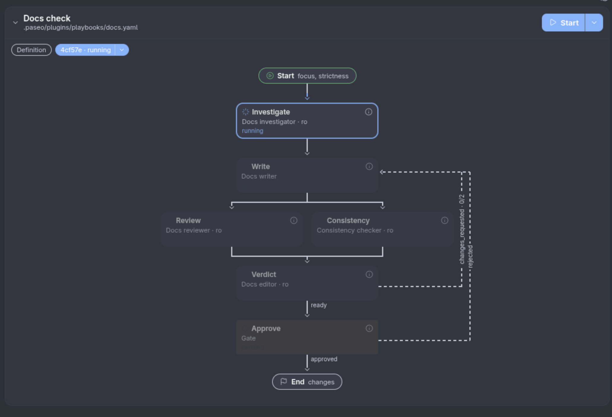
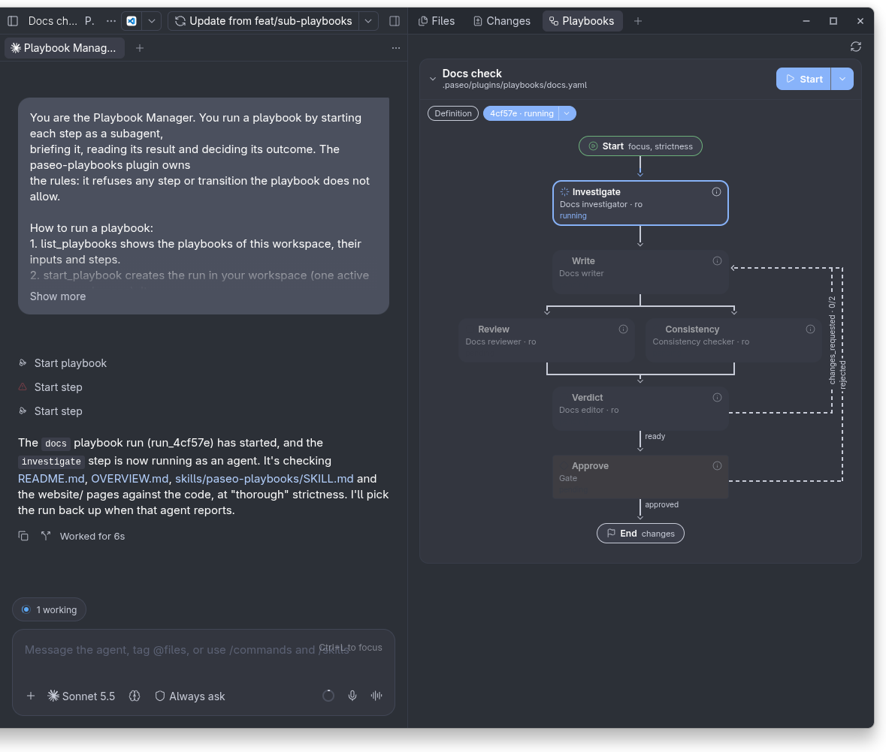
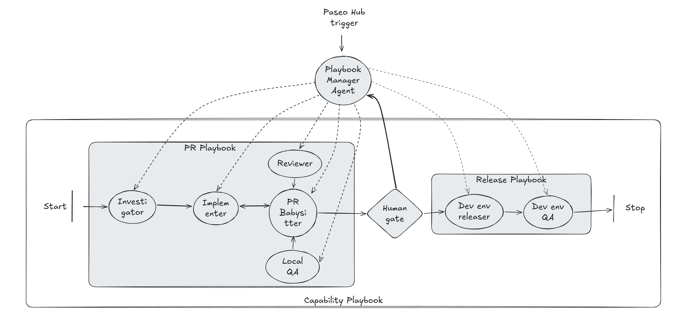

# Paseo Playbooks

> [!WARNING]
> Until v1.0, any minor release may change the playbook YAML format in breaking ways. Pin the
> plugin to a release tag (`paseo plugin install https://github.com/lerenn/paseo-playbooks.git --ref v0.7.0`,
> then `paseo plugin update paseo-playbooks --ref <tag>`) and read the release notes before upgrading.

Paseo plugin for multi-agent workflows: write a playbook in YAML, and a manager agent runs
each step as a subagent, in parallel or in loops, through to the human approval gates. See [OVERVIEW.md](OVERVIEW.md) for what it does and
[docs/adrs/2026-11-02-design.md](docs/adrs/2026-11-02-design.md) for the design.

The example playbook from the overview (fix, then review and test in parallel, then a human
gate), as a graph. The source is [assets/example-flow.mmd](assets/example-flow.mmd):




The panel next to the Playbook Manager's conversation, while a step runs:



How the Playbook Manager drives steps, human gates and nested playbooks:



## Layout

| Path | Contents |
| --- | --- |
| `index.server.ts`, `server/` | Daemon side: YAML loader and validator, run engine, run store, agent tools, hooks, RPC handlers |
| `index.client.tsx`, `client/` | The Playbooks panel (graph, node sheet, Start form), header button, and the sidebar entry with its all-workspaces screen |
| `shared/` | Zod types, RPC contracts, graph and template helpers |
| `examples/.paseo/plugins/playbooks/` | Example playbooks (PR, Release to dev, and Capability, which combines them as sub-playbooks) and their roles (not loaded by the plugin) |
| `.paseo/plugins/playbooks/` | This repository's own Docs check playbook (`docs.yaml`), which checks its docs, and its roles |
| `skills/paseo-playbooks/SKILL.md` | Agent skill for writing playbooks; copy or symlink it into a repo's `.agents/skills/` or `.claude/skills/` |

## Develop

```bash
npm install
npm run typecheck
npm test
```

Install on a local daemon from a stable checkout (not a Paseo worktree, which can be
archived), then reload after each change:

```bash
paseo plugin install "$PWD"
paseo plugin reload paseo-playbooks
paseo plugin logs paseo-playbooks
```

To use playbooks in a repository, copy `examples/.paseo/plugins/playbooks/` into it (as
`.paseo/plugins/playbooks/` or `.paseo/playbooks/`),
adjust the roles and playbooks and commit them. Then open the Playbooks panel in a workspace of
that repository and press Start. Start runs the playbook with the workspace's most
recently used agent as manager (see Known limits), in that workspace (the run starts at
once, but if that agent is busy, its kickoff waits until its current turn ends). The arrow
next to Start offers "Start on a new agent", which creates a new manager agent in the same
workspace, and "Start in a new workspace", which creates a new worktree and manager.

## Release

The version lives in `package.json`, and `package-lock.json` must carry the same one. A pull
request that changes shipped files (`client/`, `server/`, `shared/`, `skills/`, `assets/`,
`index.*`, `paseo-plugin.json` or `OVERVIEW*.md`) must bump it, or CI fails; CI also fails when
the two files differ:

```bash
npm version patch --no-git-tag-version   # or minor / major
```

When a new version reaches `main`, the Release workflow tags it `vX.Y.Z` and creates a GitHub
release. To update the Paseo Cafe listing, reply on the registry review PR (or open a new
submission) with that tag.

## Known limits

- Reloading the plugin (`paseo plugin reload`) removes the playbook tools from agents that
  are already running. They get the tools back when their session restarts.
- If the daemon restarts before a busy agent's queued kickoff is delivered, the kickoff is
  lost (the queue is kept in memory only). After the restart the agent gets a short "carry
  on" note, but never got the manager instructions. If it does not pick the run up, cancel
  the run from the panel and start again.
- After a daemon restart, recovery starts at the plugin's first event (the app connecting, an
  agent opening a session), not when the daemon starts. A step's timeout keeps counting while
  the daemon is down.
- After a plugin update, idle agents whose session holds the old plugin's tools are reloaded (history
  kept) so they stop failing with "Tool not found"; an agent mid-turn is reloaded when its turn ends,
  never one waiting on a permission or question. Turn off with `reload_stale_sessions: false` in
  `defaults/main.yaml`. Agents from before v0.51.0 are reloaded only if they belong to a run
  (see `docs/adrs/2026-11-09-reload-stale-sessions.md`).
- `list_playbooks` and `validate_playbooks` return a compact view by default (`results[].id`, `.valid`, `.errors`); `view: "full"` and `playbookId` give the detail.
- Loop feedback (a `goto` back) goes in `complete_step`'s `summary`, not in `outputs`.
- `isolation: worktree` is prompt-directed: Paseo pins an agent's directory to its workspace, so agents
  start in the workspace and are told (and, by the guard, checked) to work only in the run's worktree.
  An agent that ignores the prompt fails its step; it is not prevented.
- Plain Start picks the workspace's most recently used agent (the one you last sent a
  message to, skipping agents that already manage a run), because the panel cannot see
  which tab has focus. To pick a specific agent, send it a message first, or use "Start on
  a new agent".
