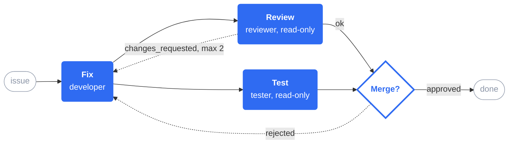

# Paseo Playbooks

> [!WARNING]
> Until v1.0, any minor release may change the playbook YAML format in breaking ways. Pin the
> plugin to a release tag (`paseo plugin install https://github.com/lerenn/paseo-playbooks.git --ref v0.7.0`,
> then `paseo plugin update paseo-playbooks --ref <tag>`) and read the release notes before upgrading.

Paseo plugin for multi-agent workflows: write a playbook in YAML, and a manager agent runs
each step as a subagent, in parallel or in loops, through to the human approval gates. See [OVERVIEW.md](OVERVIEW.md) for what it does and
[docs/adrs/2026-11-02-design.md](docs/adrs/2026-11-02-design.md) for the design.

The example playbook from the overview (fix, then review and test in parallel, then a human
gate), as a graph. The source is [assets/example-flow.mmd](assets/example-flow.mmd):

The panel next to the Playbook Manager's conversation, while a step runs:

How the Playbook Manager drives steps, human gates and nested playbooks:

## Layout

| Path | Contents |
| --- | --- |
| `index.server.ts`, `server/` | Daemon side: YAML loader and validator, run engine, run store, agent tools, hooks, RPC handlers |
| `index.client.tsx`, `client/` | The Playbooks panel (graph, node sheet, Start form), header button, and the sidebar entry with its all-workspaces screen |
| `shared/` | Zod types, RPC contracts, graph and template helpers |
| `examples/.paseo/plugins/playbooks/` | Example playbooks (PR, Release to dev, and Capability, which combines them as sub-playbooks) and their roles (not loaded by the plugin) |
| `.paseo/plugins/playbooks/` | This repository's own Docs check playbook (`docs.yaml`), which checks its docs, and its roles |
| `examples/.paseo/plugins/playbooks/sidekick/` | A starter Sidekick (`sidekick.yaml`, `instructions.md`) |
| `skills/paseo-playbooks/SKILL.md` | Agent skill for writing playbooks; copy or symlink it into a repo's `.agents/skills/` or `.claude/skills/` |

## The Sidekick

The Playbooks screen has a **Sidekick** button that opens a chat column on its right, with one tab per project
that has active runs or a Sidekick, and a **+** tab to add another project. A project's Sidekick is a
coordinator agent defined by a `sidekick/` folder beside its playbooks (`sidekick/sidekick.yaml` for provider,
model, mode, thinking and the events it `watch`es; `sidekick/instructions.md` for the repository's rules). It
runs in a hidden background workspace on the project root, watches the project's runs, judges which decisions
could be automated, and sends subagents to change the playbooks in pull requests that you merge. It has no
shell or file tools of its own. A project without the folder shows a short tutorial and a button that writes
starter files. The `sidekick/` folder is not a playbook, so a playbook named `sidekick` still works.

You can paste or drop images and files (web) in the Sidekick's message box (up to 8 per message; images 5 MB,
